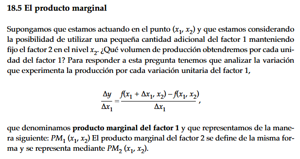
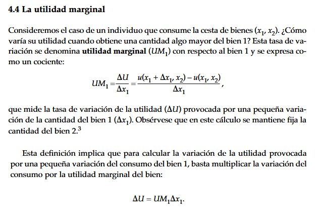
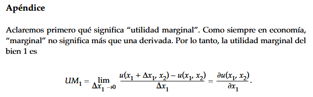
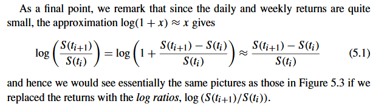
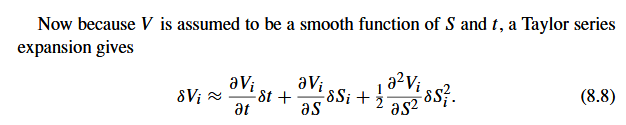

<!-- BORRADOR GENERADO: generar_libro.py -->

::: {.callout-note appearance="simple" icon=false}
**Borrador.** Este capítulo se ha generado a partir de las transparencias del tema 2:
conserva definiciones, fórmulas y figuras, pero aún falta el texto explicativo.
Mientras tanto, la [presentación](../transparencias/tema2/web/tema2.html) y el
[PDF](../transparencias/tema2/Trans_tema2.pdf) están disponibles.
:::


## Cálculo de derivadas parciales {#apartado-1}

### Derivada de función real de una variable real

Sea $f : A \subseteq \mathbb{R} \to \mathbb{R}$, con $x \to y = f(x)$


::: {.block}
$$
f'(x_o) = \frac{df}{dx}(x_0) = \lim_{h\to 0} \frac{f(x_0 + h) - f(x_0)}{h}
$$
:::

::: {.contenedor}
{.figura}
Interpretación geométrica de la derivada.
:::


### Derivada de función real de varias variables | Función de dos variables

Sea $f : A \subseteq \mathbb{R}^2 \to \mathbb{R}$, con $(x,y) \to z = f(x,y)$

La [ derivada parcial de $f$ respecto a $x$ ]{.btextbf} en el punto $(x_o, y_o)$ se define como:

$$
\lim_{h\to 0} \frac{f(x_o + h, y_o) - f(x_o, y_o)}{h}
$$

**Notación:**

$$
\frac{\partial z}{\partial x}(x_o, y_o) = f_x(x_o, y_o) = \frac{\partial f}{\partial x}(x_o, y_o)
$$


### Derivada parcial de $f$ con respecto a $x$

::: {.columns}
::: {.column width="55%"}
{.figura}

:::

::: {.column width="45%"}
{.figura}

:::
:::


### Derivada de función real de varias variables | Función de dos variables

De manera análoga, la [ derivada parcial de $f$ respecto a $y$ ]{.btextbf} en el punto $(x_o, y_o)$ se define como:

$$
\lim_{h\to 0} \frac{f(x_o, y_o + h) - f(x_o, y_o)}{h}
$$

**Notación:**

$$
\frac{\partial z}{\partial y}(x_o, y_o) = f_y(x_o, y_o) = \frac{\partial f}{\partial y}(x_o, y_o)
$$


### Derivada parcial de $f$ con respecto a $y$

::: {.columns}
::: {.column width="55%"}
{.figura}

:::

::: {.column width="45%"}
{.figura}

:::
:::


### Aplicaciones económicas | Productividad marginal

[Productividad marginal](http://es.wikipedia.org/wiki/Productividad_marginal)

{width=75%}
[Fuente: Varian, *Microeconomía intermedia*, §18.5]{.source}

### Aplicaciones económicas | Utilidad marginal

[Utilidad marginal](http://es.wikipedia.org/wiki/Utilidad_marginal)

::: {.columns}
::: {.column width="55%"}
{width=100%}
:::

::: {.column width="45%"}
{width=100%}
:::
:::

[Fuente: Varian, *Microeconomía intermedia*, §4.4 y apéndice]{.source}

### Aplicaciones económicas | Elasticidad

[Elasticidad](http://es.wikipedia.org/wiki/Elasticidad_%28economía%29)

$$
\eta_{f\_x} = \frac{x}{f(x,y)} \cdot \frac{\partial f}{\partial x}(x,y) \qquad \eta_{f\_y} = \frac{y}{f(x,y)} \cdot \frac{\partial f}{\partial y}(x,y)
$$


## La diferencial total {#apartado-2}

### Variación de la función

Para dos variables, la variación que experimenta la función real de dos variables reales $z = f(x,y)$ cuando se incrementa una sola variable independiente, manteniendo la otra constante, se aproxima mediante:
$$ \Delta z \approx \frac{\partial f}{\partial x}(x_0,y_0) \Delta x \qquad  \Delta z \approx \frac{\partial f}{\partial y}(x_0,y_0) \Delta y$$

La variación que experimenta la función real de dos variables reales $z = f(x,y)$ cuando se incrementan simultáneamente las dos variables independientes $x$ e $y$:

$$
\Delta z \approx \frac{\partial f}{\partial x}(x_0,y_0) \Delta x + \frac{\partial f}{\partial y}(x_0,y_0) \Delta y
$$

### Diferencial total | Definición

La [ diferencial total ]{.btextbf} se define como:

::: {.block}
$$
dz = \frac{\partial f}{\partial x} dx + \frac{\partial f}{\partial y} dy
$$
:::


### Para $n$ variables

Para una función $f : \mathbb{R}^n \to \mathbb{R}$, con $z = f(x_1, x_2, \ldots, x_n)$, la diferencial total en el punto $(a_0,\ldots,a_n)$ es:

$$
dz = \frac{\partial f}{\partial x_1} (a_0,\ldots,a_n)dx_1 + \frac{\partial f}{\partial x_2} (a_0,\ldots,a_n)dx_2 + \cdots + \frac{\partial f}{\partial x_n} (a_0,\ldots,a_n)dx_n
$$

O en notación compacta:

$$
dz = \sum_{i=1}^{n} \frac{\partial f}{\partial x_i} (a_0,\ldots,a_n)dx_i
$$


### Interpretación geométrica de la diferencial total

::: {.contenedor}
{.figura}

La diferencial total $dz$ representa el cambio en $z$ sobre el plano tangente a la superficie.
:::


## El vector gradiente {#apartado-3}

### Vector gradiente | Definición

El **vector gradiente** de una función $f$ en un punto es el vector que tiene su origen en ese punto y cuyas componentes son las derivadas parciales de la función en él.

[ Para $n=2$ (dos variables): ]{.ctextbf}

::: {.block}
$$
\nabla f(x_o, y_o) = \left( \frac{\partial f}{\partial x}(x_o, y_o), \frac{\partial f}{\partial y}(x_o, y_o) \right)
$$
:::

[ Para $n$ variables: ]{.ctextbf}

$$
\nabla f(a_1, \ldots, a_n) = \left( \frac{\partial f}{\partial x_1}(a_1,\ldots,a_n), \ldots, \frac{\partial f}{\partial x_n} (a_1,\ldots,a_n)\right)
$$


### Vector gradiente | Propiedades

1. **Dirección:** El vector gradiente $\nabla f(\mathbf{x}_o)$ es perpendicular a la curva de nivel de la función que pasa por el punto $\mathbf{x}_o$.

2. **Sentido:** 
   - El sentido de $\nabla f(\mathbf{x}_o)$ indica la dirección de **máximo crecimiento** de $f$ en $\mathbf{x}_o$.
   - El sentido de $-\nabla f(\mathbf{x}_o)$ indica la dirección de **máximo decrecimiento** de $f$ en $\mathbf{x}_o$.

3. **Módulo:** El módulo $\|\nabla f(\mathbf{x}_o)\|$ es la medida del máximo crecimiento o decrecimiento de la función.


### Vector gradiente | Representación gráfica

::: {.columns}
::: {.column width="50%"}
{.figura}
:::

::: {.column width="50%"}
{.figura}
:::
:::

El gradiente $\nabla f$ es perpendicular a las curvas de nivel y apunta en la dirección de **máximo crecimiento**.


### Vector gradiente 

{.figura}
## Regla de la cadena para derivadas parciales {#apartado-4}

### Regla de la cadena | Funciones de una variable

Si $y = f(x)$ y $x = g(t)$, entonces:

::: {.block}
$$
\frac{dy}{dt} = \frac{dy}{dx} \cdot \frac{dx}{dt}
$$
:::

Si $y = f(g(t))$, entonces: $\frac{dy}{dt} = f'(g(t))\cdot g'(t)$


### Regla de la cadena | Caso 1

[ Caso 1: Dos variables intermedias, una independiente ]{.ctextbf}

Si $z = f(x, y)$, donde $x = x(t)$ y $y = y(t)$, entonces:

::: {.block}
$$
\frac{dz}{dt} = \frac{\partial z}{\partial x} \frac{dx}{dt} + \frac{\partial z}{\partial y} \frac{dy}{dt}
$$
:::

{.figura}
### Regla de la cadena | Caso 2

[ Caso 2: Variable intermedia y variable independiente compartida ]{.ctextbf}

Si $z = f(x, y)$, donde $y = y(x)$, entonces:

::: {.block}
$$
\frac{dz}{dx} = \frac{\partial f}{\partial x} + \frac{\partial f}{\partial y} \frac{dy}{dx}
$$
:::

{.figura}
### Regla de la cadena | Caso 3

[ Caso 3: Dos variables intermedias, dos independientes ]{.ctextbf}

Si $z = f(x, y)$, donde $x = x(s, t)$ y $y = y(s, t)$, entonces:

::: {.block}
$$
\frac{\partial z}{\partial s} = \frac{\partial z}{\partial x} \frac{\partial x}{\partial s} + \frac{\partial z}{\partial y} \frac{\partial y}{\partial s}
\qquad
\frac{\partial z}{\partial t} = \frac{\partial z}{\partial x} \frac{\partial x}{\partial t} + \frac{\partial z}{\partial y} \frac{\partial y}{\partial t}
$$
:::

{.figura}
### Regla de la cadena | Caso 4

[ Caso 4: Tres variables intermedias, dos independientes ]{.ctextbf}

Si $w = f(x, y, z)$, donde $x = x(s, t)$, $y = y(s, t)$, $z = z(s, t)$:

::: {.columns}
::: {.column width="55%"}
::: {.block}
$$
\frac{\partial w}{\partial s} = \frac{\partial w}{\partial x} \frac{\partial x}{\partial s} + \frac{\partial w}{\partial y} \frac{\partial y}{\partial s} + \frac{\partial w}{\partial z} \frac{\partial z}{\partial s}
$$

$$
\frac{\partial w}{\partial t} = \frac{\partial w}{\partial x} \frac{\partial x}{\partial t} + \frac{\partial w}{\partial y} \frac{\partial y}{\partial t} + \frac{\partial w}{\partial z} \frac{\partial z}{\partial t}
$$
:::
:::

::: {.column width="45%"}
{.figura}
:::
:::


### Regla de la cadena | Caso general

[ Caso general ]{.ctextbf}

Si $z = f(x_1, x_2, \ldots, x_n)$, donde cada $x_i = x_i(t_1, t_2, \ldots, t_m)$, entonces:

$$
\frac{\partial z}{\partial t_j}=\frac{\partial z}{\partial x_1}\frac{\partial x_1}{\partial t_j}+\cdots+\frac{\partial z}{\partial x_n}\frac{\partial x_n}{\partial t_j}
$$

::: {.block}
$$
\frac{\partial z}{\partial t_j} = \sum_{i=1}^{n} \frac{\partial f}{\partial x_i} \frac{\partial x_i}{\partial t_j}, \quad j = 1, 2, \ldots, m
$$
:::

## Derivación implícita de ecuaciones {#apartado-5}

### Teorema de la función implícita 

[ Teorema de la función implícita (caso $F(x,y) = c$) ]{.btextbf}

Sea $F(x, y) = c$ una ecuación que define implícitamente $y = y(x)$.

**Condiciones:**

1. La función $F(x, y)$ es continua en el punto $(x_0, y_0)$.
2. Las derivadas parciales $\frac{\partial F}{\partial x}$ y $\frac{\partial F}{\partial y}$ existen y son continuas en ese punto.
3. $\frac{\partial F}{\partial y}(x_0, y_0) \neq 0$


### Derivación implícita | Cálculo de $\frac{dy}{dx}$ {.smaller}

::: {.columns}
::: {.column width="60%"}
Si $F(x, y) = 0$ define implícitamente $y = y(x)$, entonces:

::: {.block}
$$
\frac{dy}{dx} = -\frac{\frac{\partial F}{\partial x}}{\frac{\partial F}{\partial y}} = -\frac{F_x}{F_y}
$$
:::
:::

::: {.column width="40%"}
{.figura}
:::
:::

**Demostración:** Derivando $F(x, y(x)) = 0$ respecto a $x$:

$$
\frac{\partial F}{\partial x} + \frac{\partial F}{\partial y} \frac{dy}{dx} = 0 \implies \frac{dy}{dx} = -\frac{F_x}{F_y}
$$


### Derivación implícita | Interpretación geométrica

{.figura}
### Teorema de la función implícita | Dos variables implícitas

[Teorema de la función implícita (caso $F(x,y,z) = c$)]{.btextbf}

Sea $F(x, y, z) = c$ una ecuación que define implícitamente $z = z(x, y)$.

**Condiciones:**

1. La función $F(x, y, z)$ es continua en $(x_0, y_0, z_0)$.
2. Las derivadas parciales de $F$ existen y son continuas en ese punto
3. $\frac{\partial F}{\partial z}(x_0, y_0, z_0) \neq 0$


### Derivación implícita | Cálculo de derivadas parciales

Si $F(x, y, z) = c$ define implícitamente $z = z(x, y)$, entonces:

$$
\frac{\partial z}{\partial x} = -\frac{\frac{\partial F}{\partial x}}{\frac{\partial F}{\partial z}} = -\frac{F_x}{F_z}
$$

$$
\frac{\partial z}{\partial y} = -\frac{\frac{\partial F}{\partial y}}{\frac{\partial F}{\partial z}} = -\frac{F_y}{F_z}
$$


### Derivación implícita | Ejemplo: superficie implícita

::: {.columns}
::: {.column width="30%"}

{.figura}
:::

::: {.column width="70%"}
$$z^2 + \left(\sqrt{x^2 + y^2} - 2\right)^2 = 1$$

{.figura}
:::
:::


## Derivadas parciales de orden superior - Teorema de Schwarz {#apartado-6}

### Derivadas parciales de orden 1

Para una función $f : \mathbb{R}^2 \to \mathbb{R}$, las derivadas parciales de primer orden son:

$$
\frac{\partial f}{\partial x} = f_x, \quad \frac{\partial f}{\partial y} = f_y
$$

Estas son a su vez funciones de $x$ e $y$, por lo que podemos derivarlas nuevamente.


### Derivadas parciales de orden 2 | Teorema de Schwarz

[ Derivadas parciales de segundo orden ]{.btextbf}


$$
\frac{\partial^2 f}{\partial x^2} = f_{xx}, \quad \frac{\partial^2 f}{\partial y^2} = f_{yy}
$$

$$
\frac{\partial^2 f}{\partial x \partial y} = f_{xy}, \quad \frac{\partial^2 f}{\partial y \partial x} = f_{yx}
$$


### Derivadas parciales de orden superior | Diagrama

::: {.contenedor}
{.figura}

Árbol de derivadas parciales de segundo orden.
:::


### Derivadas parciales de orden 1 | Varias variables

Para una función $f : \mathbb{R}^n \to \mathbb{R}$, con $f(x_1, x_2, \ldots, x_n)$, las derivadas parciales de primer orden son:

$$
\frac{\partial f}{\partial x_1}, \quad \frac{\partial f}{\partial x_2}, \quad \ldots, \quad \frac{\partial f}{\partial x_n}
$$

En total hay **$n$ derivadas parciales de primer orden**.


### Derivadas parciales de orden 2 | Varias variables

Para $n$ variables, las derivadas de segundo orden son:

$$
\frac{\partial^2 f}{\partial x_i \partial x_j}, \quad i, j = 1, 2, \ldots, n
$$

Hay **$n^2$ derivadas parciales de segundo orden**, pero por el Teorema de Schwarz, solo $\frac{n(n+1)}{2}$ son distintas.

**Ejemplo para $n=3$:**

$$
f_{11}, f_{22}, f_{33}, f_{12} = f_{21}, f_{13} = f_{31}, f_{23} = f_{32}
$$


## La matriz hessiana {#apartado-7}

### La matriz hessiana | Funciones de 2 variables

[ Matriz hessiana (Hessiano) ]{.btextbf}


$$
H_f = \begin{pmatrix}
\frac{\partial^2 f}{\partial x^2} & \frac{\partial^2 f}{\partial x \partial y} \\[0.3em]
\frac{\partial^2 f}{\partial y \partial x} & \frac{\partial^2 f}{\partial y^2}
\end{pmatrix}
= \begin{pmatrix}
f_{xx} & f_{xy} \\[0.3em]
f_{yx} & f_{yy}
\end{pmatrix}
$$

Por el Teorema de Schwarz, $H_f$ es una matriz [ simétrica ]{.ctextbf}: $\frac{\partial^2 f}{xy} = \frac{\partial^2 f}{yx}$.

### La matriz hessiana | Funciones de n variables

$$
H_f = \begin{pmatrix}
\frac{\partial^2 f}{\partial x_1^2} & \frac{\partial^2 f}{\partial x_1 \partial x_2} & \cdots & \frac{\partial^2 f}{\partial x_1 \partial x_n} \\[0.5em]
\frac{\partial^2 f}{\partial x_2 \partial x_1} & \frac{\partial^2 f}{\partial x_2^2} & \cdots & \frac{\partial^2 f}{\partial x_2 \partial x_n} \\[0.5em]
\vdots & \vdots & \ddots & \vdots \\[0.3em]
\frac{\partial^2 f}{\partial x_n \partial x_1} & \frac{\partial^2 f}{\partial x_n \partial x_2} & \cdots & \frac{\partial^2 f}{\partial x_n^2}
\end{pmatrix}
$$


### Matriz hessiana | Definida positiva/negativa

::: {.columns}
::: {.column width="25%"}

- **Definida positiva:** La función es <span style="color:blue">**convexa</span>**.

- **Definida negativa:** La función es <span style="color:red">**cóncava</span>**.

:::

::: {.column width="75%"}
{.figura}
:::
:::


## Aproximación de funciones de varias variables {#apartado-8}

### Fórmula de Taylor | Funciones de 1 variable

Para una función $f : \mathbb{R} \to \mathbb{R}$, la aproximación de Taylor de grado $k$ alrededor de $x_0$ es:

$$
p_k(x) = f(x_0) + f'(x_0)(x - x_0) + \frac{f''(x_0)}{2!}(x - x_0)^2 + \cdots + \frac{f^{(k)}(x_0)}{k!}(x - x_0)^n
$$


### Fórmula de Taylor | Grados 1, 2, 3

[Grado 1 (aproximación lineal):]{.ctextbf}

$$
p_1(x) = f(x_0) + f'(x_0)(x - x_0)
$$

[Grado 2 (aproximación cuadrática):]{.ctextbf}

$$
p_2(x) = f(x_0) + f'(x_0)(x - x_0) + \frac{f''(x_0)}{2}(x - x_0)^2
$$

[Grado 3:]{.ctextbf}

$$
p_3(x) = f(x_0) + f'(x_0)(x - x_0) + \frac{f''(x_0)}{2}(x - x_0)^2 + \frac{f'''(x_0)}{6}(x - x_0)^3
$$


### Serie de Taylor | Visualización

::: {.columns}
::: {.column width="33%"}
{.figura}

a) Grado 1
:::

::: {.column width="33%"}
{.figura}

b) Grado 2
:::

::: {.column width="33%"}
{.figura}

c) Grado 3
:::
:::

Aproximaciones de Taylor de $e^x$ en $x_0 = 0$. En <span style="color:blue">azul</span> $e^x$, en <span style="color:red">rojo</span> la aproximación.
### Aplicación financiera | Taylor de 1 variable

Aproximación de rendimientos logarítmicos mediante Taylor de grado 1:

{width=85%}
[Fuente: Higham, *An Introduction to Financial Option Valuation*, Cambridge University Press (2004), §5]{.source}

### Fórmula de Taylor | 2 variables, grado 1

Para $f : \mathbb{R}^2 \to \mathbb{R}$, la aproximación de Taylor de grado 1 alrededor de $(x_o, y_o)$ es:

$$
p_1(x, y) = f(x_0, y_0) + f_x(x_0, y_0)(x - x_0) + f_y(x_0, y_0)(y - y_0)
$$

Esto es equivalente a la **aproximación mediante el plano tangente**.

::: {.block}
$$
p_1(x, y) = f(x_0, y_0) +\nabla f(x_0, y_0) \cdot \begin{pmatrix} dx \\ dy \end{pmatrix}
$$

:::

### Fórmula de Taylor | 2 variables, grado 2

La aproximación de Taylor de grado 2 para dos variables es:

\begin{align*}
p_2(x,y) =& f(x_0, y_0) + f_x(x_0, y_0)(x - x_0) + f_y(x_0, y_0)(y - y_0) \\
& + \frac{1}{2} \left[ f_{xx}(x_0, y_0)(x - x_0)^2 + 2f_{xy}(x_0, y_0)(x - x_0)(y - y_0) \right. \\
& \left. + f_{yy}(x_0, y_0)(y - y_0)^2 \right]
\end{align*}

::: {.block}
$$
p_2(x, y) = p_1(x,y)+\frac{1}{2} \begin{pmatrix} dx & dy \end{pmatrix} H_f(x_0, y_0) \begin{pmatrix} dx \\ dy \end{pmatrix}
$$

:::


### Aplicación financiera | Taylor de 2 variables

Expansión de Taylor para valoración de opciones financieras (lema de Itô):

{width=85%}
[Fuente: Higham, *An Introduction to Financial Option Valuation*, Cambridge University Press (2004), §8]{.source}


## Funciones homogéneas {#apartado-9}

### Funciones homogéneas | Definición

Una función $f$ es [ homogénea de grado $k$ ]{.ctextbf} si para todo $\lambda > 0$:

**Para 2 variables:**

$$
f(\lambda x, \lambda y) = \lambda^k f(x, y)
$$

**Para $n$ variables:**

$$
f(\lambda x_1, \lambda x_2, \ldots, \lambda x_n) = \lambda^k f(x_1, x_2, \ldots, x_n)
$$


### Funciones homogéneas | Propiedades

[ Propiedades de funciones homogéneas ]{.btextbf}

1. Si $f$ y $g$ son homogéneas de grado $k$, entonces $f + g$ es homogénea de grado $k$.

2. Si $f$ es homogénea de grado $k$ y $\alpha$ es un escalar, entonces $\alpha f$ es homogénea de grado $k$.

3. Si $f$ y $g$ son homogéneas de grado $k$ y $m$ respectivamente, entonces $fg$ es homogénea de grado $k + m$.

4. Si $f$ y $g$ son homogéneas de grado $k$ y $m$ respectivamente, entonces $\frac{f}{g}$ es homogénea de grado $k - m$ (donde $g \neq 0$).

5. Si $f$ es homogénea de grado $k$ y derivable hasta orden $m$, las derivadas parciales de orden $m$ son homogéneas de grado $k - m$.


### Funciones homogéneas | Rendimientos a escala

En economía, las funciones de producción homogéneas se clasifican por sus **rendimientos a escala**:

- **$k = 1$**: Rendimientos [ constantes ]{.ctextbf} a escala. La producción varía en igual proporción que los factores productivos.

- **$k > 1$**: Rendimientos [ crecientes ]{.ctextbf} a escala. La producción crece en mayor proporción que los factores productivos.

- **$k < 1$**: Rendimientos [ decrecientes ]{.ctextbf} a escala. La producción crece en menor proporción que los factores productivos.


### Funciones homogéneas | Teorema de Euler

[ Teorema de Euler para funciones homogéneas ]{.btextbf}

Si $f$ es homogénea de grado $k$ y diferenciable, entonces:

**Para 2 variables:**

::: {.block}
$$
x \frac{\partial f}{\partial x} + y \frac{\partial f}{\partial y} = k f(x, y)
$$
:::

**Para $n$ variables:**
$$
\sum_{i=1}^{n} x_i \frac{\partial f}{\partial x_i} = k f(x_1, \ldots, x_n)
$$


## Introducción a la integración múltiple - Integral doble {#apartado-10}

### Integral de función real de variable real | Recordatorio

::: {.columns}
::: {.column width="45%"}

[ Integral definida en $\mathbb{R}$ ]{.btextbf}

Para $f : [a, b] \to \mathbb{R}$, la integral definida es:

$$
\int_a^b f(x) \, dx
$$

:::

::: {.column width="55%"}
{.figura}
:::
:::


### Integral de función real de dos variables reales

::: {.columns}
::: {.column width="45%"}

[ Integral doble ]{.btextbf}

Para $f : R \subseteq \mathbb{R}^2 \to \mathbb{R}$, la integral doble es:

$$
 \iint_R f(x, y) \, dx \, dy = \iint_R f(x, y) \, dA
$$

:::

::: {.column width="55%"}
{.figura}
:::
:::


### Integral doble | Propiedades

[ Propiedades de la integral doble ]{.btextbf}

1. **Linealidad:**

   $$
   \iint_R [\alpha f(x,y) + \beta g(x,y)] \, dA = \alpha \iint_R f(x,y) \, dA + \beta \iint_R g(x,y) \, dA
   $$

2. **Aditividad sobre regiones:**

   Si $R = R_1 \cup R_2$ con $R_1 \cap R_2 = \emptyset$:

   $$
   \iint_R f(x,y) \, dA = \iint_{R_1} f(x,y) \, dA + \iint_{R_2} f(x,y) \, dA
   $$

### Integral doble | Propiedades (2)

[ Propiedades de la integral doble ]{.btextbf}


3. **Monotonía:** Si $f(x,y) \leq g(x,y)$ en $R$:

   $$
   \iint_R f(x,y) \, dA \leq \iint_R g(x,y) \, dA
   $$

4. **Funciones separables:** Si $f(x,y) = f_1(x) \cdot f_2(y)$ y $R = [a,b] \times [c,d]$:

   $$
   \iint_R f_1(x) \cdot f_2(y) \, dA = \left(\int_a^b f_1(x) \, dx\right) \cdot \left(\int_c^d f_2(y) \, dy\right)
   $$


### Integral doble | Teorema de Fubini

[ Teorema de Fubini ]{.btextbf}

Si $f$ es continua sobre el rectángulo $R = [a, b] \times [c, d]$, entonces:

::: {.block}
$$
\iint_R f(x, y) \, dA = \int_a^b \left[ \int_c^d f(x, y) \, dy \right] dx = \int_c^d \left[ \int_a^b f(x, y) \, dx \right] dy
$$
:::


### {.plain}

```{=latex}
\FinalPageContent
```
