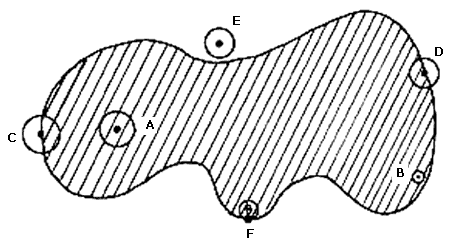
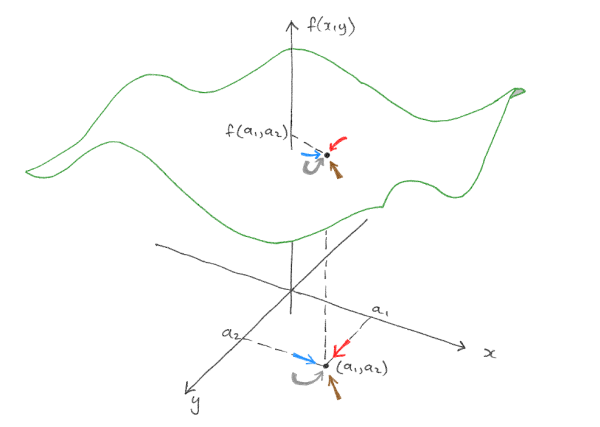

# Funciones de varias variables

## Nociones topológicas en $\mathbb{R}^n$ | $n=1$

::: {.block}
### $\mathbb{R}$ es la recta unidimensional
:::

::: {#fig-recta-real}
\begin{tikzpicture}[axis label]

% Recta real
\draw[axis, <->] (-3,0) -- (3,0);

% Marcas de números enteros
\foreach \i in {-2,...,2}
  \draw (\i,0.1) -- ++(0,-0.2) node[below, font=\small] {$\i$};

% Etiqueta ℝ
\node[above, font=\small] at (0,0.2) {$\mathbb{R}$};

% Símbolos de infinito
\node[below, font=\small] at (3,-0.1) {$\infty$};
\node[below, font=\small] at (-3,-0.1) {$-\infty$};

\end{tikzpicture}

Representación de la recta real unidimensional.
:::

## Nociones topológicas en $\mathbb{R}^n$ | $n=2$

:::{.block}
### $\mathbb{R}^2$ es el plano real 
$$n=2\rightarrow \mathbb{R}^2 = \mathbb{R}\times \mathbb{R} =\left\{(x_1,x_2):x_i\in\mathbb{R},i=1,2\right\}$$
:::

::: {#fig-plano}
\begin{tikzpicture}[scale=1.2, axis label, cap=round]

% Rejilla de fondo
\draw[grid style] (-1.4,-1.4) grid (1.4,1.4);

% Ejes cartesianos
\draw[axis] (-1.5,0) -- (1.5,0) node[right] {$x$};
\draw[axis] (0,-1.5) -- (0,1.5) node[above] {$y$};

% Etiquetas de los ejes
\foreach \x/\xtext in {-1, -0.5/-\frac{1}{2}, 0.5/\frac{1}{2}, 1}
  \draw (\x, 1pt) -- (\x, -1pt) node[tick label] {$\xtext$};

\foreach \y/\ytext in {-1, -0.5/-\frac{1}{2}, 0.5/\frac{1}{2}, 1}
  \draw (1pt, \y) -- (-1pt, \y) node[tick label left] {$\ytext$};

% Vectores componentes
\draw[vector primary, semithick] (0.1,0.1) -- (0.1,0.5);
\draw[vector primary, semithick] (0.1,0.1) -- (0.5,0.1);

% Punto representativo
\node[point, red] at (0.5,0.5) {};
\node[point label, right, xshift=2pt] at (0.5,0.5) {$(x_0,y_0)$};

\end{tikzpicture}
Representación del plano real $\mathbb{R}^2$.
:::

## Nociones topológicas en $\mathbb{R}^n$ | $n=3$

:::{.block}
### $\mathbb{R}^3$ es el espacio real tridimensional
$$n=3\rightarrow \mathbb{R}^3 = \mathbb{R}\times \mathbb{R} \times \mathbb{R} =\left\{(x_1,x_2, x_3):x_i\in\mathbb{R},i=1,2,3\right\}$$
:::

::: {#fig-espacio}
\begin{tikzpicture}[scale=0.8]
\begin{axis}[
        width=8cm, height=8cm,
        view={322.5}{30},
        axis lines=center,
        3d box=background,
        xmin=-2, xmax=2, ymin=-2, ymax=2, zmin=-2, zmax=2,
        xtick={-2,-1,1,2}, ytick={-2,-1,1,2}, ztick={-2,-1,1,2},
        xlabel={$x$}, ylabel={$y$}, zlabel={$z$},
        tick label style={font=\tiny},
        label style={font=\small},
        grid=none,
        every axis x label/.style={at={(ticklabel* cs:1.05)}, anchor=west},
        every axis y label/.style={at={(ticklabel* cs:1.05)}, anchor=south west},
        every axis z label/.style={at={(ticklabel* cs:1.05)}, anchor=south},
        compat=1.18
    ]

    % Vectores unitarios desde el origen (direcciones de los ejes)
    \draw[red!80!black, ->, thick] (0,0,0) -- (0.5,0,0);
    \draw[red!80!black, ->, thick] (0,0,0) -- (0,0.5,0);
    \draw[red!80!black, ->, thick] (0,0,0) -- (0,0,0.5);

    % Punto representativo
    \coordinate (P) at (0, -0.7, 1);

    % Proyección al plano xy
    \draw[dashed, gray!60, thin] (P) -- (0, -0.7, 0);

    % Punto en el espacio
    \fill[red] (P) circle (1.5pt);
    \node[right, font=\tiny, xshift=2pt] at (P) {$(x_0,y_0,z_0)$};

\end{axis}
\end{tikzpicture}

Representación del espacio real tridimensional $\mathbb{R}^3$.
:::

## Nociones topológicas en $\mathbb{R}^n$ | General

En general para $n\in \mathbb{N}$, $\mathbb{R}^n$ es un espacio n-dimensional

$$\mathbb{R}^n = \mathbb{R}\times \cdots \times \mathbb{R} =\left\{(x_1,\ldots, x_n):x_i\in\mathbb{R},i=1,\ldots,n\right\}$$

- Vector en $\mathbb{R}^n$

$$\vec{x}=(x_1,\ldots, x_n) \rightarrow \begin{pmatrix}x_1\\ \vdots\\ x_n\end{pmatrix}$$

## Operaciones con vectores | Suma de vectores


$$\vec{x},\vec{y}\in \mathbb{R}^n,\, \vec{x}=(x_1,\ldots, x_n),\, \vec{y}=(y_1,\ldots, y_n)$$
$$\vec{x}+\vec{y}=(x_1+y_1,\ldots, x_n+y_n)$$

::: {#fig-suma-vectores}
\begin{tikzpicture}[scale=2.4, axis label, cap=round]

\draw[grid style] (-1.4,-1.4) grid (1.4,1.4);

% Ejes cartesianos
\draw[axis] (-1.5,0) -- (1.5,0) node[right] {$x$};
\draw[axis] (0,-1.5) -- (0,1.5) node[above] {$y$};

% Etiquetas de los ejes
\foreach \x/\xtext in {-1, -.5/-\frac{1}{2}, .5/\frac{1}{2}, 1}
  \draw (\x,1pt) -- (\x,-1pt) node[tick label] {$\xtext$};

\foreach \y/\ytext in {-1, -.5/-\frac{1}{2}, .5/\frac{1}{2}, 1}
  \draw (1pt,\y) -- (-1pt,\y) node[tick label left] {$\ytext$};

% Vectores principales
\draw[vector primary] (0,0) -- node[left] {${\bar{u}}$} (0.3,1.2);
\draw[vector secondary] (0,0) -- node[above] {${\bar{v}}$} (0.8,0.1);

% Construcción del paralelogramo
\draw[vector primary, dashed, xshift=0.8cm, yshift=0.1cm] (0,0) -- (0.3,1.2);
\draw[vector secondary, dashed, xshift=0.3cm, yshift=1.2cm] (0,0) -- (0.8,0.1);

% Vector resultante
\draw[vector tertiary] (0,0) -- node[below=2pt, fill=white] {${\bar{u}}+{\bar{v}}$} (1.1,1.3);

\end{tikzpicture}

Suma de vectores $\bar{u}$ y $\bar{v}$.
:::

## Operaciones con vectores | Producto de escalar vector

$$\lambda\in \mathbb{R},\, \vec{x}\in \mathbb{R}^n,\, \vec{x}=(x_1,\ldots, x_n)$$
$$\lambda\vec{x}=\lambda (x_1,\ldots, x_n) =( \lambda x_1,\ldots, \lambda x_n)$$

::: {#fig-producto-escalar-vector}
\begin{tikzpicture}[scale=2.4, axis label, cap=round]

\draw[grid style] (-1.4,-1.4) grid (1.4,1.4);

% Ejes cartesianos
\draw[axis] (-1.5,0) -- (1.5,0) node[right] {$x$};
\draw[axis] (0,-1.5) -- (0,1.5) node[above] {$y$};

% Etiquetas de los ejes
\foreach \x/\xtext in {-1, -.5/-\frac{1}{2}, .5/\frac{1}{2}, 1}
  \draw (\x,1pt) -- (\x,-1pt) node[tick label] {$\xtext$};

\foreach \y/\ytext in {-1, -.5/-\frac{1}{2}, .5/\frac{1}{2}, 1}
  \draw (1pt,\y) -- (-1pt,\y) node[tick label left] {$\ytext$};

% Vector original
\draw[vector secondary] (0,0) -- (0.5,0.3) node[above] {$\bar{v}$};

% Construcción del producto escalar (3v)
\draw[vector primary, thick] (0,0) -- (0.5,0.3);
\draw[vector primary, thick] (0.5,0.3) -- (1,0.6);
\draw[vector primary, thick] (1,0.6) -- (1.5,0.9) node[above] {${3\bar{v}}$};

\end{tikzpicture}

Producto del escalar 3 por el vector $\bar{v}$.
:::

## Operaciones con vectores | Combinación lineal

$$\vec{z}=\alpha\vec{x}+\beta \vec{y}\in \mathbb{R}^n$$

$$\vec{z}=\alpha\vec{x}+\beta \vec{y} = \alpha (x_1,\ldots, x_n) + \beta (y_1,\ldots, y_n)$$

$$= (\alpha x_1,\ldots, \alpha x_n) +  (\beta y_1,\ldots, \beta y_n) = (\alpha x_1 + \beta y_1,\ldots, \alpha x_n + \beta y_n)$$

## Operaciones con vectores | Combinación lineal 

::: {#fig-combinacion-lineal}
\begin{tikzpicture}[scale=2.4, axis label, cap=round]

\draw[grid style] (-1.4,-1.4) grid (1.4,1.4);

% Ejes cartesianos
\draw[axis] (-1.5,0) -- (1.5,0) node[right] {$x$};
\draw[axis] (0,-1.5) -- (0,1.5) node[above] {$y$};

% Etiquetas de los ejes
\foreach \x/\xtext in {-1, -.5/-\frac{1}{2}, .5/\frac{1}{2}, 1}
  \draw (\x,1pt) -- (\x,-1pt) node[tick label] {$\xtext$};

\foreach \y/\ytext in {-1, -.5/-\frac{1}{2}, .5/\frac{1}{2}, 1}
  \draw (1pt,\y) -- (-1pt,\y) node[tick label left] {$\ytext$};

% Vectores base (más gruesos para destacar)
\draw[vector, black, line width=1.2pt] (0,0) -- node[below] {$\bar{v}$} (0.4,0);
\draw[vector, black, line width=1.2pt] (0,0) -- node[left] {$\bar{u}$} (0.1,0.3);

% Ejemplo 1: 3u + 2v (azul)
\draw[vector secondary, thick] (0,0) -- (1.2,0);
\draw[vector secondary, thick] (0,0) -- (0.2,0.6);
\draw[vector dashed, xshift=1.2cm] (0,0) -- (0.2,0.6);
\draw[vector dashed, xshift=0.2cm, yshift=0.6cm] (0,0) -- (1.2,0);
\draw[vector primary, thick] (0,0) -- node[left, fill=white] {$3\bar{u}+2\bar{v}$} (1.4,0.6);

% Ejemplo 2: 2u - 3v (teal)
\draw[vector quaternary, thick] (0,0) -- (0.8,0);
\draw[vector quaternary, thick] (0,0) -- (-0.3,-0.9);
\draw[vector dashed, xshift=0.8cm] (0,0) -- (-0.3,-0.9);
\draw[vector dashed, xshift=-0.3cm, yshift=-0.9cm] (0,0) -- (0.8,0);
\draw[vector primary, thick] (0,0) -- node[right, fill=white] {$2\bar{u}-3\bar{v}$} (0.5,-0.9);

% Ejemplo 3: -3.5u - 1.5v (magenta)
\draw[vector quinary, thick] (0,0) -- (-1.4,0);
\draw[vector quinary, thick] (0,0) -- (-0.15,-0.45);
\draw[vector dashed, xshift=-1.4cm] (0,0) -- (-0.15,-0.45);
\draw[vector dashed, xshift=-0.15cm, yshift=-0.45cm] (0,0) -- (-1.4,0);
\draw[vector primary, thick] (0,0) -- node[left, fill=white] {$-3.5\bar{u}-1.5\bar{v}$} (-1.55,-0.45);

% Ejemplo 4: -2u + v (gris)
\draw[vector senary, thick] (0,0) -- (-0.8,0);
\draw[vector senary, thick] (0,0) -- (0.1,0.3);
\draw[vector dashed, xshift=-0.8cm] (0,0) -- (0.1,0.3);
\draw[vector dashed, xshift=0.1cm, yshift=0.3cm] (0,0) -- (-0.8,0);
\draw[vector primary, thick] (0,0) -- node[fill=white] {$-2\bar{u}+\bar{v}$} (-0.7,0.3);

\end{tikzpicture}

Ejemplos de combinaciones lineales de los vectores $\bar{u}$ y $\bar{v}$.
:::

## Operaciones con vectores | Producto escalar

$$\vec{x},\vec{y}\in \mathbb{R}^n,\, \vec{x}=(x_1,\ldots, x_n),\, \vec{y}=(y_1,\ldots, y_n)$$

$$\langle\vec{x},\vec{y}\rangle = (x_1,\ldots, x_n)\begin{pmatrix}y_1\\ \vdots\\ y_n\end{pmatrix} = x_1y_1+\cdots+x_ny_n$$

## Operaciones con vectores | Norma euclídea


$$\vec{x}\in \mathbb{R}^n,\, \vec{x}=(x_1,\ldots, x_n)$$

$$\lVert\vec{x}\rVert=\sqrt{x_1^2+\ldots+x_n^2}=\sqrt{\sum^n_{i=1}x^2_i}$$

La norma euclídea mide la longitud del vector.

## Operaciones con vectores | Norma euclídea

::: {.columns}

::: {.column width="50%"}
**Propiedades**

1. $\lVert\vec{x}\rVert\geq 0,\quad \lVert\vec{x}\rVert=0 \iff \vec{x}=\vec{0}$

2. $\lVert\lambda \vec{x}\rVert = \lambda \lVert \vec{x}\rVert$

3. $\lVert\vec{x} + \vec{y}\rVert \leq  \lVert \vec{x}\rVert + \lVert \vec{y}\rVert$

4. $\left\lVert\frac{\vec{x}}{\lVert\vec{x}\rVert}\right\rVert = 1,\, \forall \vec{x}\neq \vec{0}$
:::

::: {.column width="50%"}
::: {#fig-desigualdad-triangular}
\begin{tikzpicture}[scale=2.4, axis label]

% Lados del triángulo
\draw[vector primary, line width=1pt] (0,0) -- node[left] {$\lVert\bar{x}\rVert$} (1,1);
\draw[vector secondary, line width=1pt] (1,1) -- node[right] {$\lVert\bar{y}\rVert$} (2,0);
\draw[vector tertiary, line width=1pt] (0,0) -- node[below] {$\lVert\bar{x}+\bar{y}\rVert$} (2,0);

\end{tikzpicture}

Desigualdad triangular.
:::
:::

:::

## Operaciones con vectores | Distancia euclídea

$$\vec{x},\vec{y}\in \mathbb{R}^n,\, \vec{x}=(x_1,\ldots, x_n),\, \vec{y}=(y_1,\ldots, y_n)$$

$$d(\vec{x},\vec{y})=\lVert\vec{x}-\vec{y}\rVert = \sqrt{(x_1-y_1)^2 + \ldots (x_n-y_n)^2 } = \sqrt{\sum^n_{i=1}(x_i-y_i)^2}$$

## Operaciones con vectores | Distancia euclídea

::: {#fig-distancia-euclidea}
\begin{tikzpicture}[scale=2.4, axis label, cap=round]

\draw[grid style] (-1.4,-1.4) grid (1.4,1.4);

% Ejes cartesianos
\draw[axis] (-1.5,0) -- (1.5,0) node[right] {$x$};
\draw[axis] (0,-1.5) -- (0,1.5) node[above] {$y$};

% Etiquetas de los ejes
\foreach \x/\xtext in {-1, -.5/-\frac{1}{2}, .5/\frac{1}{2}, 1}
  \draw (\x,1pt) -- (\x,-1pt) node[tick label] {$\xtext$};

\foreach \y/\ytext in {-1, -.5/-\frac{1}{2}, .5/\frac{1}{2}, 1}
  \draw (1pt,\y) -- (-1pt,\y) node[tick label left] {$\ytext$};

% Vectores desde el origen
\draw[vector primary] (0,0) -- node[left] {$\bar{u}$} (0.3,1.2);
\draw[vector secondary] (0,0) -- node[left] {$\bar{v}$} (0.8,0.1);

% Vector diferencia
\draw[vector tertiary] (0.3,1.2) -- node[above=4pt, fill=white, sloped] {$\bar{u}-\bar{v}$} (0.8,0.1);

% Línea de medida para la distancia
\draw[thick, <->] ($(0.3,1.2)+(0.05,0.05)$) -- ($(0.8,0.1)+(0.05,0.05)$)
  node[midway, above, sloped, fill=white] {$d(u,v)$};

\end{tikzpicture}

Distancia euclídea entre vectores $\bar{u}$ y $\bar{v}$.
:::

## Operaciones con vectores | Distancia euclídea

**Propiedades**

1. $d(\vec{x},\vec{y})\geq 0$

2. $d(\vec{x},\vec{y}) = 0 \iff \vec{x}=\vec{y}$

3. $d(\vec{x},\vec{y}) =  d(\vec{y},\vec{x})$

4. $d(\vec{x},\vec{y}) \leq  d(\vec{x},\vec{z}) + d(\vec{z},\vec{y})$

## Bolas en $\mathbb{R}^n$

- Bola abierta con centro en $\vec{x}_0\in \mathbb{R}^n$ y radio $r\in \mathbb{R}$

$$B(\vec{x}_0,r) = \{\vec{x}\in\mathbb{R}^n:d(\vec{x},\vec{x}_0)<r\}$$

- Bola cerrada con centro en $\vec{x}_0\in \mathbb{R}^n$ y radio $r\in \mathbb{R}$

$$\overline{B}(\vec{x}_0,r) = \{\vec{x}\in\mathbb{R}^n:d(\vec{x},\vec{x}_0)\leq r\}$$

## Bolas en $\mathbb{R}^n$ | $n=1$

- **Bola abierta** con centro en $x_0\in \mathbb{R}$ y radio $r\in \mathbb{R}$

$$B(x_0,r) = \{x\in\mathbb{R}:d(x,x_0)<r\} = (x_0-r, x_0+r)$$

- **Bola cerrada** con centro en $x_0\in \mathbb{R}$ y radio $r\in \mathbb{R}$

$$\overline{B}(x_0,r) = \{x\in\mathbb{R}:d(x,x_0)\leq r\} = [x_0-r, x_0+r]$$

## Bolas en $\mathbb{R}^n$ | $n=1$

::: {#fig-bola-r1-abierta}
\begin{tikzpicture}[scale=1.3, axis label]

% Recta real
\draw[axis, <->] (-3,0) -- (3,0);

% Marcas en la recta
\foreach \x/\xtext in {-1.8/$x_0-r$, 0/$x_0$, 1.8/$x_0+r$}
  \draw[thick] (\x,2pt) -- (\x,-2pt) node[below, font=\small] {\xtext};

% Intervalo abierto (sin puntos en los extremos)
\draw[thick, blue!70!black, line width=1.5pt] (-1.8,0) -- (1.8,0);
\filldraw[white, draw=blue!70!black, thick] (-1.8,0) circle (2.5pt);
\filldraw[white, draw=blue!70!black, thick] (1.8,0) circle (2.5pt);

% Etiqueta
\node[left, font=\small] at (-4.25,0) {$B(x_0,r)$};

\end{tikzpicture}

Bola abierta: $(x_0-r, x_0+r)$
:::

\vspace{0.5cm}

::: {#fig-bola-r1-cerrada}
\begin{tikzpicture}[scale=1.3, axis label]

% Recta real
\draw[axis, <->] (-3,0) -- (3,0);

% Marcas en la recta
\foreach \x/\xtext in {-1.8/$x_0-r$, 0/$x_0$, 1.8/$x_0+r$}
  \draw[thick] (\x,2pt) -- (\x,-2pt) node[below, font=\small] {\xtext};

% Intervalo cerrado (con puntos rellenos en los extremos)
\draw[thick, blue!70!black, line width=1.5pt] (-1.8,0) -- (1.8,0);
\filldraw[blue!70!black] (-1.8,0) circle (2.5pt);
\filldraw[blue!70!black] (1.8,0) circle (2.5pt);

% Etiqueta
\node[left, font=\small] at (-4.25,0) {$\overline{B}(x_0,r)$};

\end{tikzpicture}

Bola cerrada: $[x_0-r, x_0+r]$
:::

## Bolas en $\mathbb{R}^n$ | $n=2$


- **Bola abierta** con centro en $\vec{x}_0=(x_0,y_0)\in \mathbb{R}^2$ y radio $r\in \mathbb{R}$

$$B(\vec{x}_0,r) = \{\vec{x}\in\mathbb{R}^2:d(\vec{x},\vec{x}_0)<r\}$$
$$= \{\vec{x}=(x,y)\in \mathbb{R}^2:(x-x_0)^2+(y-y_0)^2<r^2\}$$

- **Bola cerrada** con centro en $\vec{x}_0=(x_0,y_0)\in \mathbb{R}^2$ y radio $r\in \mathbb{R}$

$$\overline{B}(\vec{x}_0,r) = \{\vec{x}\in\mathbb{R}^2:d(\vec{x},\vec{x}_0)\leq r\}$$
$$= \{\vec{x}=(x,y)\in \mathbb{R}^2:(x-x_0)^2+(y-y_0)^2\leq r^2\}$$

## Bolas en $\mathbb{R}^n$ | $n=2$

::: {.columns}

::: {.column width="50%"}
::: {#fig-bola-r2-abierta}
\begin{tikzpicture}[scale=1.4, axis label]

% Ejes cartesianos
\draw[axis] (-1.5,0) -- (1.5,0) node[right] {$x$};
\draw[axis] (0,-1.5) -- (0,1.5) node[above] {$y$};

% Etiquetas de los ejes
\foreach \x/\xtext in {-1, -.5/-\frac{1}{2}, .5/\frac{1}{2}, 1}
  \draw (\x,1pt) -- (\x,-1pt) node[tick label] {$\xtext$};

\foreach \y/\ytext in {-1, -.5/-\frac{1}{2}, .5/\frac{1}{2}, 1}
  \draw (1pt,\y) -- (-1pt,\y) node[tick label left] {$\ytext$};

% Bola abierta (dashed circle)
\filldraw[ball fill, ball open] (0.5,0.5) circle (0.4);

% Centro de la bola
\node[point, gray] at (0.5,0.5) {};
\node[below, font=\tiny] at (0.5,0.5) {$(x_0,y_0)$};

% Radio
\draw[dashed, thin] (0.1,0.5) -- (0.5,0.5);
\node[above, font=\tiny] at (0.3,0.5) {$r$};

\end{tikzpicture}

Bola abierta
:::
:::

::: {.column width="50%"}
::: {#fig-bola-r2-cerrada}
\begin{tikzpicture}[scale=1.4, axis label]

% Ejes cartesianos
\draw[axis] (-1.5,0) -- (1.5,0) node[right] {$x$};
\draw[axis] (0,-1.5) -- (0,1.5) node[above] {$y$};

% Etiquetas de los ejes
\foreach \x/\xtext in {-1, -.5/-\frac{1}{2}, .5/\frac{1}{2}, 1}
  \draw (\x,1pt) -- (\x,-1pt) node[tick label] {$\xtext$};

\foreach \y/\ytext in {-1, -.5/-\frac{1}{2}, .5/\frac{1}{2}, 1}
  \draw (1pt,\y) -- (-1pt,\y) node[tick label left] {$\ytext$};

% Bola cerrada (solid circle)
\filldraw[ball fill, ball closed] (0.5,0.5) circle (0.4);

% Centro de la bola
\node[point, gray] at (0.5,0.5) {};
\node[below, font=\tiny] at (0.5,0.5) {$(x_0,y_0)$};

% Radio
\draw[dashed, thin] (0.1,0.5) -- (0.5,0.5);
\node[above, font=\tiny] at (0.3,0.5) {$r$};

\end{tikzpicture}

Bola cerrada
:::
:::

:::

## Bolas en $\mathbb{R}^n$ | $n=3$


- **Bola abierta** con centro en $\vec{x}_0=(x_0,y_0,z_0)\in \mathbb{R}^3$ y radio $r\in \mathbb{R}$

$$B(\vec{x}_0,r) = \{\vec{x}\in\mathbb{R}^3:d(\vec{x},\vec{x}_0)< r\}$$
$$= \{\vec{x}=(x,y,z)\in \mathbb{R}^3:(x-x_0)^2+(y-y_0)^2+(z-z_0)^2< r^2\}$$

- **Bola cerrada** con centro en $\vec{x}_0=(x_0,y_0,z_0)\in \mathbb{R}^3$ y radio $r\in \mathbb{R}$

$$\overline{B}(\vec{x}_0,r) = \{\vec{x}\in\mathbb{R}^3:d(\vec{x},\vec{x}_0)\leq r\}$$
$$= \{\vec{x}=(x,y,z)\in \mathbb{R}^3:(x-x_0)^2+(y-y_0)^2+(z-z_0)^2\leq r^2\}$$

## Bolas en $\mathbb{R}^n$ | $n=3$

::: {.columns}

::: {.column width="50%"}
::: {#fig-bola-r3-abierta}
\begin{tikzpicture}[scale=0.9]
\begin{axis}[
        view={60}{30},
        width=8cm,
        height=8cm,
        axis equal image,
        xmin=-2, xmax=2,
        ymin=-2, ymax=2,
        zmin=-2, zmax=2,
        axis lines=center,
        xlabel={$x$}, ylabel={$y$}, zlabel={$z$},
        tick label style={font=\tiny},
        label style={font=\small},
        every axis x label/.style={at={(ticklabel* cs:1.05)}, anchor=west},
        every axis y label/.style={at={(ticklabel* cs:1.05)}, anchor=south west},
        every axis z label/.style={at={(ticklabel* cs:1.05)}, anchor=south},
        compat=1.18
    ]
    \addplot3[
        mesh,
        z buffer=sort,
        point meta=-z,
        samples=20,
        domain=-1:1,
        y domain=0:2*pi,
        line width=0.3pt,
        color=blue!60!black,
        opacity=0.6
    ]
    (
        {sqrt(1-x^2) * cos(deg(y))},
        {sqrt(1-x^2) * sin(deg(y))},
        x
    );
\end{axis}
\end{tikzpicture}

Bola abierta
:::
:::

::: {.column width="50%"}
::: {#fig-bola-r3-cerrada}
\begin{tikzpicture}[scale=0.9]
\begin{axis}[
        view={60}{30},
        width=8cm,
        height=8cm,
        axis equal image,
        xmin=-2, xmax=2,
        ymin=-2, ymax=2,
        zmin=-2, zmax=2,
        axis lines=center,
        xlabel={$x$}, ylabel={$y$}, zlabel={$z$},
        tick label style={font=\tiny},
        label style={font=\small},
        every axis x label/.style={at={(ticklabel* cs:1.05)}, anchor=west},
        every axis y label/.style={at={(ticklabel* cs:1.05)}, anchor=south west},
        every axis z label/.style={at={(ticklabel* cs:1.05)}, anchor=south},
        compat=1.18
    ]
    \addplot3[
        surf,
        shader=flat,
        z buffer=sort,
        point meta=-z,
        samples=25,
        domain=-1:1,
        y domain=0:2*pi,
        colormap/cool,
        opacity=0.8
    ]
    (
        {sqrt(1-x^2) * cos(deg(y))},
        {sqrt(1-x^2) * sin(deg(y))},
        x
    );
\end{axis}
\end{tikzpicture}

Bola cerrada
:::
:::

:::

## Definiciones topológicas

Sea $A\subseteq \mathbb{R}^n$

- **Conjunto complementario**

  $A^c=\{\vec{x}\in \mathbb{R}^n:\vec{x}\notin A\}= \mathbb{R}^n-A$

- **[Punto interior](http://en.wikipedia.org/wiki/Interior_points)**

  $\vec{x}_0\in Int(A)\iff\exists r>0:B(\vec{x}_0,r)\subseteq A$

- **[Punto exterior](http://en.wikipedia.org/wiki/Exterior_%28topology%29)**

  $\vec{x}_0\in Ext(A)\iff\exists r>0:B(\vec{x}_0,r)\cap A = \emptyset \iff \vec{x}_0\in Int(A^c)$

- **[Punto frontera](http://en.wikipedia.org/wiki/Boundary_%28topology%29)**

  $\vec{x}_0\in Fr(A) \iff \forall r>0: B(\vec{x}_0,r)\cap A \neq \emptyset \land B(\vec{x}_0,r)\cap A^c \neq \emptyset$

## Definiciones topológicas

::: {#fig-puntos-topologicos}
{width=80%}

Puntos interiores, exteriores y frontera. Fuente: [Biblioteca Digital ILCE \faExternalLink*](https://intranet.matematicas.uady.mx/portal/leamos_ciencia/VOLUMEN_II/ciencia3/075/imgs/75_24.gif)
:::

## Definiciones topológicas | Conjuntos

Sea $A\subseteq \mathbb{R}^n$

- **Conjunto abierto**

  $A=Int(A)$

- **Conjunto cerrado**

  $A^c = Int(A^c) \iff A = Int(A)\cup Fr(A)$

- **Conjunto acotado**

  $\forall \vec{x}\in A \implies \exists r>0: \lVert \vec{x}_0 \rVert\leq r\implies \exists r>0: A\subseteq B(\vec{x},r)$

- **Conjunto compacto**

  Si es cerrado y acotado

## Funciones reales de varias variables

::: {.block}
### Definición
Una función $f$ real de varias variables es una operación que asigna a un vector n-dimensional $\vec{x}$ de cierto conjunto un valor real $f(\vec{x})$

$$\begin{array}{c}
f:D\subseteq\mathbb{R}^n\to\mathbb{R}\\
\vec{x}=(x_1,\ldots,x_n)\to f(\vec{x})
\end{array}$$
:::

## Funciones reales de varias variables | Operaciones

Sean $f,g:D\subseteq \mathbb{R}^n\to \mathbb{R}, \, h:E\subseteq \mathbb{R}\to \mathbb{R},\, \alpha,\beta\in \mathbb{R}$

- **Combinación lineal de funciones**

  $(\alpha f +\beta g)(\vec{x})=\alpha f(\vec{x}) +\beta g(\vec{x})$

- **Producto de funciones**

  $(f\cdot g)(\vec{x})=f(\vec{x})\cdot g(\vec{x})$

- **Cociente de funciones**

  $\frac{f}{g}(\vec{x})=\frac{f(\vec{x})}{g(\vec{x})}, \, \forall \vec{x}\in D$ tal que $g(\vec{x})\neq 0$

- **Composición de funciones**

  $(h\circ f)(\vec{x})=h(f(\vec{x})) , \, \forall \vec{x}\in D$ tal que $f(\vec{x})\in E$

# Dominio y curvas de nivel

## Dominio

::: {.block}
### Definición
Es el conjunto de puntos $\vec{x}\in \mathbb{R}^n$ donde la función está definida. Es decir, el conjunto de puntos $\vec{x}\in \mathbb{R}^n$ para los que $f(\vec{x})$ es un valor real.

$$Dom(f)=\{\vec{x}\in \mathbb{R}^n :\exists y\in \mathbb{R}\mbox{ tal que } y=f(\vec{x})\}$$
:::

## Gráfica

::: {.block}
### Definición
Es el conjunto de puntos $(x_1,\ldots,x_n,z)\in \mathbb{R}^{n+1}$ del espacio n+1 dimensional, tal que $z=f(x_1,\ldots,x_n)\in \mathbb{R}$

$$Graf(f)=\{(x_1,\ldots,x_n,z)\in \mathbb{R}^{n+1}:z=f(x_1,\ldots,x_n)\}\subseteq \mathbb{R}^{n+1}$$
:::

## Gráfica 

::: {#fig-grafica-3d}
\begin{tikzpicture}[scale=0.8]
\begin{axis}[
    xlabel={$x$},
    ylabel={$y$},
    label style={font=\small},
    tick label style={font=\tiny},
    width=10cm,
    height=8cm,
    colormap/viridis,
    compat=1.18
]
% Superficie con mallado integrado
\addplot3[
    surf,
    shader=faceted interp,
    samples=25,
    domain=-2:2,
    domain y=-1.3:1.3,
    z buffer=sort,
    faceted color=black,
    line width=0.3pt
]
    {exp(-x^2-y^2)*x};
\end{axis}
\end{tikzpicture}

Gráfica de la función $f(x,y) = x \exp(-x^2-y^2)$.
:::

## Curvas de nivel

::: {.block}
### Definición
Se denomina conjunto de nivel de $f$ al conjunto de puntos del espacio n-dimensional $(x_1,\ldots,x_n)\in \mathbb{R}^{n}$ tal que

$$N_c(f)=\{(x_1,\ldots,x_n)\in \mathbb{R}^{n}:f(x_1,\ldots,x_n)=c\}\subseteq \mathbb{R}^{n}$$
:::

## Curvas de nivel 

::: {#fig-curvas-nivel-mesh}
\begin{tikzpicture}[scale=0.8]
\begin{axis}[
    xlabel={$x$},
    ylabel={$y$},
    label style={font=\small},
    tick label style={font=\tiny},
    width=10cm,
    height=8cm,
    colormap/viridis,
    compat=1.18
]
\addplot3[
    mesh,
    samples=25,
    domain=-2:2,
    domain y=-1.3:1.3,
    line width=0.4pt,
    z buffer=sort
]
{exp(-x^2-y^2)*x};
\end{axis}
\end{tikzpicture}

Mallado 3D de la función $f(x,y) = x \exp(-x^2-y^2)$.
:::

## Curvas de nivel 

::: {#fig-contornos-verticales}
\begin{tikzpicture}[scale=0.8]
\begin{axis}[
    domain=-2:2,
    domain y=-1.3:1.3,
    zmin=-0.8, zmax=0.5,
    samples=50,
    xlabel={$x$},
    ylabel={$y$},
    zlabel={$z$},
    label style={font=\small},
    tick label style={font=\tiny},
    width=10cm,
    height=8cm,
    colormap/viridis,
    compat=1.18
]
% Contornos verticales en 3D (cortes horizontales)
\addplot3[
    contour gnuplot={number=14, labels={true}},
    samples=50,
    thick
]
    {exp(-x^2-y^2)*x};

% Contornos proyectados en la base
\addplot3[
    contour gnuplot={
        output point meta=rawz,
        number=10,
        labels=false
    },
    samples=50,
    z filter/.code=\def\pgfmathresult{-0.8}
]
    {exp(-x^2-y^2)*x};

\end{axis}
\end{tikzpicture}

Cortes horizontales y proyección de curvas de nivel de $f(x,y) = x \exp(-x^2-y^2)$.
:::

## Curvas de nivel 

::: {#fig-curvas-nivel-plano}
\begin{tikzpicture}[scale=0.8]
\begin{axis}[
    domain=-2:2,
    domain y=-1.3:1.3,
    enlarge x limits,
    view={0}{90},
    samples=50,
    xlabel={$x$},
    ylabel={$y$},
    label style={font=\small},
    tick label style={font=\tiny},
    width=10cm,
    height=8cm,
    colormap/viridis,
    compat=1.18
]
\addplot3[
    contour gnuplot={number=14, labels=true},
    thick
]
    {exp(-x^2-y^2)*x};
\end{axis}
\end{tikzpicture}

Curvas de nivel en el plano con valores $c$ de $f(x,y) = x \exp(-x^2-y^2)$.
:::

# Límites y continuidad

## Límites

- El límite de $f:D\subseteq \mathbb{R}^n\to\mathbb{R}$ en el punto $\vec{x}_0\in\mathbb{R}^n$ es el $L\in \mathbb{R}$ si y solamente si se cumple lo siguiente

$$\forall \epsilon>0,\exists \delta>0:\vec{x}\in B(\vec{x}_0,\delta)\cap D\implies \lvert f(\vec{x})-L\rvert<\epsilon$$

lo que equivale a decir que

$$\forall \epsilon>0,\exists \delta>0:\vec{x}\in D \quad d(\vec{x},\vec{x}_0)<\delta \implies \lvert f(\vec{x})-L\rvert<\epsilon$$

$$\lim_{\vec{x}\to\vec{x}_0} f(\vec{x})=L$$

## Límites 

::: {#fig-limite-visualizacion}
{width=70%}

Límite de funciones de 2 variables. Fuente: [MathOnline \faExternalLink*](http://mathonline.wikidot.com/limits-of-functions-of-two-variables)
:::

## Límites | Límite por trayectorias

**Teorema:** Si el límite de una función $f(\vec{x})$ cuando $\vec{x}$ tiende a $\vec{a}$ existe y vale $l$, entonces el límite de esa función cuando $\vec{x}$ tiende a $\vec{a}$ a lo largo de cualquier trayectoria también existe y vale $l$. Por lo tanto, si para trayectorias distintas se obtienen valores del límite diferentes, se deduce que el límite de la función en ese punto **NO EXISTE**.

## Límites 

::: {#fig-limite-trayectorias}
{width=70%}

Límite de funciones de 2 variables por trayectorias. Fuente: Geoff Coates
:::

## Límites | Propiedades

Sean $f(\vec{x}), \, g(\vec{x})$, funciones definidas en $D\subseteq \mathbb{R}^n$ y $h:E\subseteq \mathbb{R}\to \mathbb{R}$, con $f(D)\subseteq E$, tales que $\lim_{\vec{x}\to\vec{a}}f(\vec{x})=l_1,\, \lim_{\vec{x}\to\vec{a}}g(\vec{x})=l_2$ y $h(l_1)=l$

Entonces:

- $\forall \alpha ,\beta  \in \mathbb{R},\;\lim_{\vec x \to \vec a} ( {\alpha f + \beta g} )( {\vec x} ) = \alpha {l_1}+\beta {l_2}$

- $\lim_{\vec x \to \vec a} (f \cdot  g )( {\vec x} ) = {l_1}\cdot{l_2}$

- Si $l_2\neq 0  \implies \lim_{\vec x \to \vec a} \frac{f}{g}( {\vec x} ) = \frac{l_1}{l_2}$

- $\lim_{\vec x \to \vec a}(h\circ f )(\vec{x})=h(l_1)=l$

## Límites | Límites iterados

$$\color{green} {L_1 = \lim_{x\to 0}( \lim_{y\to 0} f(x,y))}\qquad \color{blue}  {L_2 = \lim_{y\to 0}( \lim_{x\to 0} f(x,y))}$$

::: {#fig-limites-iterativos}
\begin{tikzpicture}[scale=1.8, axis label, cap=round]

\draw[grid style] (-1.4,-1.4) grid (1.4,1.4);

% Ejes cartesianos
\draw[axis] (-1.5,0) -- (1.5,0) node[right] {$x$};
\draw[axis] (0,-1.5) -- (0,1.5) node[above] {$y$};

% Etiquetas de los ejes
\foreach \x/\xtext in {-1, -.5/-\frac{1}{2}, .5/\frac{1}{2}, 1}
  \draw (\x,1pt) -- (\x,-1pt) node[tick label] {$\xtext$};

\foreach \y/\ytext in {-1, -.5/-\frac{1}{2}, .5/\frac{1}{2}, 1}
  \draw (1pt,\y) -- (-1pt,\y) node[tick label left] {$\ytext$};

% Punto inicial
\node[point, red!80!white] at (0.5,0.5) {};
\node[right, font=\tiny] at (0.5,0.5) {$(x_0,y_0)$};

% Camino 1: primero y→0, luego x→0 (verde)
\draw[->, dashed, green!70!black, thick] (0.5,0.5) -- node[right=1pt, fill=white] {1. ${y\to 0}$} (0.5,0);
\draw[->, dashed, green!70!black, thick] (0.5,0) -- node[below=1pt, fill=white] {2. ${x\to 0}$} (0,0);

% Camino 2: primero x→0, luego y→0 (azul)
\draw[->, dashed, blue!80!black, thick] (0.5,0.5) -- node[above=1pt, fill=white] {1. ${x\to 0}$} (0,0.5);
\draw[->, dashed, blue!80!black, thick] (0,0.5) -- node[left=2pt, fill=white] {2. ${y\to 0}$} (0,0);

\end{tikzpicture}

Límites iterados: dos caminos diferentes para calcular el límite.
:::

## Límites | Coordenadas polares

\vspace{0.3cm}

::: {.columns}

::: {.column width="40%"}
**Cambio de coordenadas:**

$$\color{blue} {x = r\cdot \cos\theta}$$
$$\color{red}  {y = r\cdot \sin \theta}$$

**Límite:**

$$\lim_{\substack{\forall \theta\\r\to 0}} f(\theta,r)$$
:::

::: {.column width="60%"}
::: {#fig-coordenadas-polares}
\begin{tikzpicture}[scale=2.2, axis label, cap=round]

\draw[grid style] (-1.4,-1.4) grid (1.4,1.4);

% Ejes cartesianos
\draw[axis] (-1.5,0) -- (1.5,0) node[right] {$x$};
\draw[axis] (0,-1.5) -- (0,1.5) node[above] {$y$};

% Etiquetas de los ejes
\foreach \x/\xtext in {-1, -.5/-\frac{1}{2}, .5/\frac{1}{2}, 1}
  \draw (\x,1pt) -- (\x,-1pt) node[tick label] {$\xtext$};

\foreach \y/\ytext in {-1, -.5/-\frac{1}{2}, .5/\frac{1}{2}, 1}
  \draw (1pt,\y) -- (-1pt,\y) node[tick label left] {$\ytext$};

% Círculo unitario
\draw[thin, gray] (0,0) circle (1cm);

% Componentes del punto en coordenadas polares
\coordinate (t) at (30:1cm);
\draw[very thick, blue] (30:1cm |- 0,0) -- node[below=2pt, fill=white] {$x = \cos \theta$} (0,0);
\draw[very thick, red] (t) -- node[right=1pt, fill=white] {$y =\sin \theta$} (30:1cm |- 0,0);

% Radio
\draw[thick, black] (0,0) -- node[above=1pt, fill=white] {$r = 1$} (t);

% Ángulo theta
\draw[thin] (0,0) -- (0.3,0) arc (0:30:0.3) -- cycle;
\node[font=\tiny] at (16:0.22) {$\theta$};

\end{tikzpicture}

Coordenadas polares 
:::
:::

:::

## Continuidad

::: {.block}
### Definición
Se dice que la función $f:D\subseteq\mathbb{R}^n\to\mathbb{R}$ es continua en $\vec{a}$ si se cumplen las siguientes condiciones:

**Condiciones:**

- La función está definida en $\vec{a}$. Es decir, $\vec{a}\in D$

- $\exists \lim_{\vec{x}\to\vec{a}}f(\vec{x})$

- $\lim_{\vec{x}\to\vec{a}}f(\vec{x})=f(\vec{a})$
:::

## {.plain}

```{=latex}
\FinalPageContent
```
